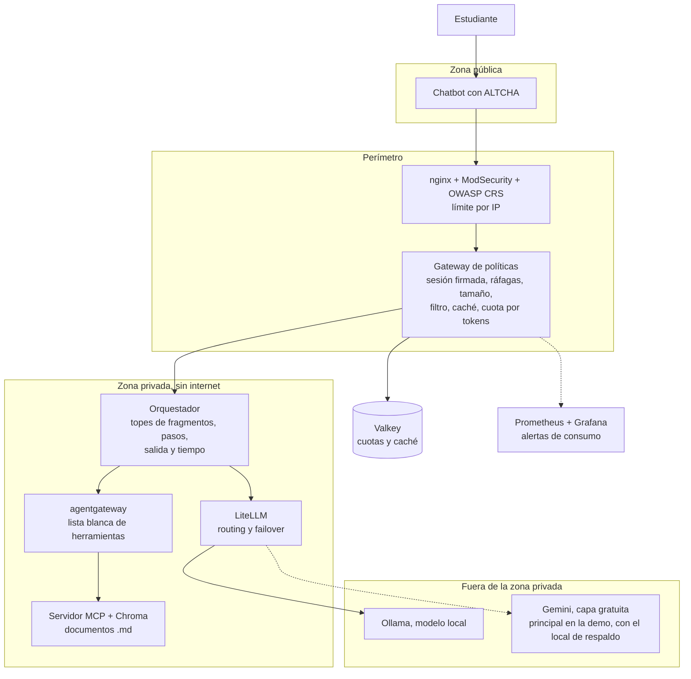

# ADR-002 — Arquitectura segura con piezas open source

**Fecha:** 06/11/2026, resultados actualizados el 07/11/2026 · **Autores:** Grupo 5 FDSI · **Estado:** Propuesto (pendiente de revisión del equipo GP-05)

Responde la pregunta abierta del [ADR-001](ADR-001-arquitectura-segura.md): la demo puede correr en una laptop con un gateway open source. La implementación está en [`infra/`](../infra/README.md).

## Contexto

El ADR-001 fija la arquitectura en Google Cloud con servicios gestionados, pero casi todos son de pago o dependen de créditos: Apigee (cerca de USD 365 al mes después de la evaluación), Cloud Armor, Model Armor, Vertex AI. El propio ADR-001 deja el gateway open source como "útil para el laboratorio".

La versión de laboratorio tampoco servía para medir: `ask_llm()` devolvía un texto fijo, el RAG no tenía documentos y todos los controles vivían en el proceso que se ataca.

## Decisión

Mantener las mismas capas, zonas y reglas del ADR-001, y reemplazar cada servicio de pago por una pieza abierta en Docker Compose. Los servicios gestionados siguen siendo la arquitectura objetivo si algún día hay presupuesto. Este ADR no los reemplaza en producción, porque hay cosas que una laptop no da (ver [Lo que se pierde](#lo-que-se-pierde)).

## Reemplazo por capa

"Implementado" quiere decir que corre en `infra/` y pasó las pruebas de abajo.

| Capa | En el ADR-001 | Reemplazo | Licencia | Estado | Alternativa |
|---|---|---|---|---|---|
| 1. Borde | Cloud Armor | nginx + ModSecurity + OWASP CRS, con límite por IP | Apache-2.0 | Implementado | Coraza (Apache-2.0, pasa el 100 % de las pruebas de CRS); CrowdSec (MIT) para compartir bloqueos |
| 2. Identidad | reCAPTCHA | ALTCHA (prueba de trabajo, sin servicios externos) + sesión JWT | MIT | Implementado, con interruptor | Anubis (MIT) |
| 3. AI Gateway | Apigee | Gateway propio en FastAPI | Propio | Implementado | Apache APISIX (Apache-2.0), por evaluar |
| 3. Filtro de prompts | Model Armor | Reglas para español e inglés | Propio | Implementado, **limitado** | NeMo Guardrails (Apache-2.0) |
| 3. Caché semántica | Apigee | Valkey + fastembed con modelo multilingüe | BSD-3 / Apache-2.0 | Implementado | — |
| 4. Orquestador | Hermes Agent en Cloud Run | Orquestador propio en FastAPI | Propio | Implementado | Hermes Agent (MIT), ver [Decisiones para el equipo](#decisiones-para-el-equipo) |
| 4. RAG | Cloud Storage + Vertex AI Vector Search | Chroma + carpeta `course_docs/` | Apache-2.0 | Implementado | Qdrant (Apache-2.0) |
| 5. Egreso a LLMs | Apigee + Vertex AI | LiteLLM + Ollama con Qwen2.5 1.5B | MIT (salvo `enterprise/`) / MIT / Apache-2.0 | Implementado | Gemini en capa gratuita, medido como el mejor para la demo (no es open source) |
| 5. Egreso a tools | Agent Gateway + Agent Registry | agentgateway | Apache-2.0 | Implementado | — |
| 5. Red privada | VPC + Service Controls | Redes internas de Docker | — | Implementado | — |
| 5. Secretos | Secret Manager | `.env` fuera de git | — | Implementado, **básico** | OpenBao (MPL-2.0) |
| 6. Detección y costo | Monitoring, Billing, SCC, SecOps | Prometheus + Grafana + tope global con corte | Apache-2.0 / AGPL-3.0 | Implementado | Wazuh como SIEM (propuesta, no implementado) |

Descartados al revisar: **LLM Guard** (Protect AI) tiene el repositorio archivado desde julio de 2026, y **MinIO** también está archivado, por lo que los documentos quedan en una carpeta simple. **Kong** deja su caché semántica para la versión enterprise, y **LiteLLM** hace lo mismo con la autenticación JWT. Por eso el ingreso se escribió a mano: no encontramos un gateway abierto que trajera todo junto.

**Redis** se cambió por Valkey, con licencia BSD y compatible con el mismo cliente.

**LiteLLM** está fijado en v1.106.2 a propósito. En marzo de 2026 sus versiones 1.82.7 y 1.82.8 en PyPI traían un robo de credenciales. Hay que actualizarlo a mano, nunca con `latest`.

## Resultados

Medición del 07/11/2026 con tokens reales, contra `unsecure` (mismo orquestador, sin gateway, 50 fragmentos) y `secure`, ya con las cuotas calibradas. Los datos están en [`infra/pruebas/resultados/`](../infra/pruebas/resultados/) y se repiten con `python medir.py --modelo gemini`, desde `infra/`.

Las versiones anteriores de este ADR daban cifras solo del simulador. No deben citarse: tenían otras cuotas y T05 estaba mal medido, porque la mitad de las preguntas salía de la caché.

| Prueba | Métrica | Gemini 3.5 Flash-Lite: sin controles → con controles | Cambio | Modelo local | Simulador |
|---|---|---|---|---|---|
| T01 Flooding de una IP (60 s; 15 s en el simulador) | Tokens | 73.200 → 1.524 | **−97,9 %** | −96,3 % | −99,8 % |
| T02 "Resume todo" | Tokens de entrada | 1.726 → 566 | **−67,2 %** | −66,2 % | −66,4 % |
| | Tokens totales | 1.735 → 862 | −50,3 % | −64,2 % | −66,4 % |
| | Prompt gigante | 3.403 → rechazado, 0 | | | |
| T03 Misma pregunta, 8 veces | Tokens | 14.038 → 669 | **−95,2 %** | −95,5 % | −95,8 % |
| T04 Ráfaga de 30 IP (120 s) | Tokens | 121.018 → 10.969 | **−90,9 %** | −88,0 % | −97,1 % |
| | Estudiante durante el ataque | 0 de 6 → 4 de 6 | | 0 de 2 → 4 de 6 | 6 de 6 → 6 de 6 |
| | Estudiante nuevo al terminar | HTTP 200 | | HTTP 200 | HTTP 200 |
| T05 Estudiantes bajo ataque (3 estudiantes, 180 s por fase; 60 s en el simulador) | Respondidos con ataque | 0 de 27 → 27 de 27 | | 15 de 15 → 27 de 27 | 9 de 9 → 9 de 9 |
| | Latencia p95 sin ataque → con ataque | Con controles: 4,4 → 2,4 s | | Con controles: 1,3 → 3,1 s; sin controles: 2,0 → 47,7 s | Con controles: 0,34 → 0,43 s |

Calidad con Gemini: 30 de 30 preguntas de control correctas, en dos corridas. Modelo local: 28 de 30, con un dato inventado sobre el Bogotazo, y por eso queda solo de respaldo.

**Contra la hipótesis de la propuesta (reducción ≥ 70 %):** se cumple en T01, T03 y T04, y **no se cumple en T02**. La entrada baja 67 % en los tres modelos. El corpus simulado solo tiene 15 fragmentos, así que `unsecure` no puede traer los 50 que permite: hay que medirlo con los documentos reales.

**Antes de calibrar, la versión segura no protegía frente a un proveedor real.** Con 5 preguntas cada 10 s y sin límite por minuto, T05 respondió solo 50 % con el ataque (corrida con `gemini-3.1-flash-lite`). Una sola sesión se comía las 15 llamadas por minuto de la capa gratuita.

### Cómo leer estos números

- **Con Gemini gratis, Google frena el ataque.** Limita a 15 llamadas por minuto (se midieron hasta 34), así que el gasto medido es bajo: T04 sin controles equivale a 0,045 USD. La escala de una cuenta de pago solo se puede proyectar: 3.774 llamadas en 2 minutos del simulador, a 0,00066 USD por llamada real, serían unos 75 USD por hora. Es una proyección, no una medición.
- **La entrada es casi todo el costo.** La salida mediana es de 18 tokens (95,5 % del gasto es entrada), mientras el simulador suponía unos 130. Por eso T02 se reporta por entrada: la salida varía de 8 a 661 tokens para la misma pregunta.
- **Pocas muestras.** T05 tiene 27 preguntas por fase y T04 solo 6. Con el modelo local, el p95 de T05 sube 2,4 veces: la propuesta pide máximo 2 veces, aunque son solo 3,1 s.
- **El proveedor varía.** Con `gemini-3.1-flash-lite` hubo errores 503, una llamada colgada de 120 s y una fase de 3 minutos con 20 % de respuestas sin ataque. `gemini-3.5-flash-lite` no tuvo errores en estas corridas.
- **Ataque lento y distribuido.** Quien reparta pocas preguntas entre muchas IP no dispara el límite de ráfagas y puede ocupar el cupo por minuto. No se probó.

### Comprobaciones

`pruebas/comprobaciones.py` y `pruebas/aislamiento.py` pasan completas (41 comprobaciones). Revisan, entre otras cosas, que:

- el WAF bloquee un ataque evidente, y que `/metrics` no salga a internet;
- los tokens con otra firma o `alg=none` se rechacen, y que un reto ALTCHA solo sirva una vez;
- al agotarse el tope global el LLM no reciba nada, y que si cae el proveedor principal responda el de respaldo;
- en modo de ahorro, la IP que ya gastó reciba 429 y una nueva siga entrando;
- el orquestador no pueda salir a internet ni llegar a Valkey, y que la herramienta `borrar_indice`, que existe en el servidor MCP, quede oculta y rechazada por agentgateway.

Con un ataque en curso se dispararon las alertas `GastoAcelerado` y `MuchosRechazos`.

El respaldo se probó con un fallo real: con la cuota de `gemini-3.1-flash-lite` agotada, el modelo local respondió las 6 preguntas de prueba en 0,6 a 8,7 s. Sin modelo local, el estudiante recibe "El modelo está ocupado" (HTTP 503) y el circuito no se abre.

## Errores que encontraron las pruebas

Quedan aquí porque son resultados del seminario, no solo detalles de código:

| Problema | Cómo se vio | Solución |
|---|---|---|
| **La caché daba respuestas de otro corte.** "¿Cuánto vale el corte 3?" y "...el corte 2?" tienen 0,95 de similitud, igual que una reformulación legítima | Midiendo pares de preguntas que no deben coincidir | Exigir los mismos números y subir el umbral de 0,86 a 0,90. Algunas reformulaciones dejan de acertar: cuestan tokens, pero no dan una respuesta equivocada |
| **El monitoreo quedaba ciego durante el ataque.** `/metrics` compartía hilos con `/ask` y Prometheus perdía las muestras | Las alertas seguían inactivas con el gasto disparado | `/metrics`, `/health` y las rutas de sesión ya no usan ese pool |
| **La cuota bloqueaba respuestas gratis.** Con la caché después de la cuota, como dice el ADR-001, un estudiante sin cuota no podía recibir respuestas que costaban 0 tokens | 50 % de éxito en T05, incluso sin ataque | Caché antes de la cuota, y cuota por sesión de 8.000 a 20.000 tokens |
| **El límite de ráfagas dejaba pasar el doble.** Era una ventana fija | Falló una comprobación que no fallaba siempre | Ventana deslizante |
| **Nuestra propia prueba inflaba el resultado.** Las preguntas del atacante caían en caché y T04 parecía −90 % en 15 s | 304 respuestas con solo 25 llamadas al LLM | Preguntas que esquivan la caché, para medir las cuotas en su peor caso |
| **Los límites calibrados con el simulador no protegían.** Una sesión se comía el cupo por minuto del proveedor | T05 con Gemini: 50 % de respuestas durante el ataque | Límite de llamadas por minuto, global y por IP; las IP ya frenadas compiten por la mitad del cupo |
| **Un ataque distribuido dejaba fuera a los estudiantes nuevos.** Era el riesgo residual del ADR-001 | T04: 429 a un estudiante nuevo al terminar | Modo de ahorro: pasado el 80 % del tope, solo entran las IP que no han gastado. Ahora responde HTTP 200 |
| **La búsqueda no encontraba términos técnicos.** Los embeddings fallan con "C4" o "derivadas" | El documento correcto quedaba en el puesto 6 de 15; 2 respuestas equivocadas con Gemini | Búsqueda híbrida con palabras clave. Sube la mediana de 383 a 428 tokens |
| **El tope diario pasaba de la cuota de Google.** 260.000 tokens son unas 600 preguntas, y Google da 500 llamadas | Cuenta hecha con la cuota medida | El tope se calcula con esa cuota: 210.000 tokens |
| **T05 estaba mal medido.** El estudiante repetía preguntas y la mitad salía de caché | Medianas de la versión segura más bajas que la latencia del propio modelo | Cada pregunta lleva un número distinto y llega al modelo |
| **El cupo del proveedor pasaba de una prueba a otra.** T01 con controles arrancaba con el cupo agotado por la prueba anterior | Solo 1 llamada en 60 s; esa corrida se descartó | Pausa de 65 s entre pruebas con proveedor real |

## Lo que se pierde

Frente a los servicios gestionados del ADR-001:

- **DDoS volumétrico real.** Ningún software en una máquina lo frena: el enlace se satura antes de llegar a nginx. Cloud Armor trabaja en una red que no tenemos.
- **Agrupar por huella TLS (JA4) y por ASN.** El borde solo agrupa por IP, y además aún no sirve HTTPS. Por eso un ataque con muchas IP solo lo frenan los límites globales y el modo de ahorro.
- **El filtro de prompts es débil.** Son reglas: reformular la frase las esquiva. No equivale a Model Armor, y hay que decirlo así en la sustentación. Este proyecto se centra en consumo, así que no es el control principal.
- **La prueba de trabajo solo encarece.** ALTCHA cobra CPU por sesión, pero no detiene a un bot decidido como lo intenta un sistema con análisis de riesgo.
- **Disponibilidad.** Todo corre en una máquina. Un gestionado sigue en pie si un servidor cae.
- **El gateway de ingreso es código nuestro.** Un error ahí es un error de seguridad y nadie más lo mantiene. Lo gestionado no tiene ese costo.
- **Detección.** No hay SIEM ni correlación de eventos: solo métricas y alertas de consumo, sin aviso por correo ni por chat.

## Decisiones para el equipo

1. **¿Hermes Agent o el orquestador propio?** El ADR-001 nombra Hermes. Se implementó un orquestador de unas 140 líneas porque el caso (buscar y responder) no necesita un agente autónomo: Hermes agrega memoria y herramientas, y por eso más superficie de ataque y más gasto de tokens. Lo importante del ADR, los topes de pasos, tiempo y salida, ya está. Si el curso exige un agente de verdad, se puede cambiar, porque LiteLLM y agentgateway no dependen de quién los llame.
2. **¿Se acepta el cambio de orden de la caché y la cuota?** Se aparta del ADR-001 por lo que se midió arriba.
3. **¿Se publica así la cifra de T02?** Conviene cargar los documentos reales y volver a medir antes de citarla.
4. **¿Demo con Gemini gratis o con cuenta de pago?** Gratis limita a 15 preguntas por minuto y Google [puede usar el contenido](https://aistudio.google.com/docs/pricing) para mejorar sus productos: con documentos reales conviene la de pago, recalculando las cuotas.
5. **¿Cuántos estudiantes lo usarán?** Las cuotas de `infra/perfiles/gemini.env` suponen 40 estudiantes y 10 preguntas al día cada uno, y eso no está medido.

## Referencias

- [Gemini API: precios](https://aistudio.google.com/docs/pricing) y [límites](https://aistudio.google.com/docs/rate-limits) (el límite de 15 por minuto y 500 al día salió del propio error de Google)
- [LiteLLM: aviso de seguridad de marzo de 2026](https://docs.litellm.ai/blog/security-update-march-2026), [análisis de NetSPI](https://www.netspi.com/?p=32614)
- [LiteLLM: JWT requiere licencia Enterprise](https://docs.litellm.ai/docs/proxy/token_auth)
- [Kong: AI Semantic Cache](https://developer.konghq.com/plugins/ai-semantic-cache/)
- [agentgateway: documentación](https://agentgateway.dev/docs/standalone/latest/about/introduction/)
- [ALTCHA: núcleo open source](https://altcha.org/open-source-captcha/)
- [OWASP CRS: opciones de motor (Coraza y ModSecurity)](https://coreruleset.org/docs/deployment/engine_integration_options)
- [Guía de frameworks de guardrails (nota sobre LLM Guard)](https://www.decryptiondigest.com/blog/llm-guardrails-framework-comparison-nemo-guardrails-ai-llm-guard)

Licencias y estado de archivado de cada repositorio revisados en la API de GitHub el 06/11/2026, salvo NeMo Guardrails, cuya licencia sale de la guía citada.
